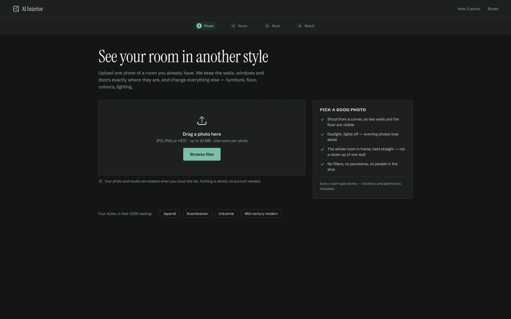
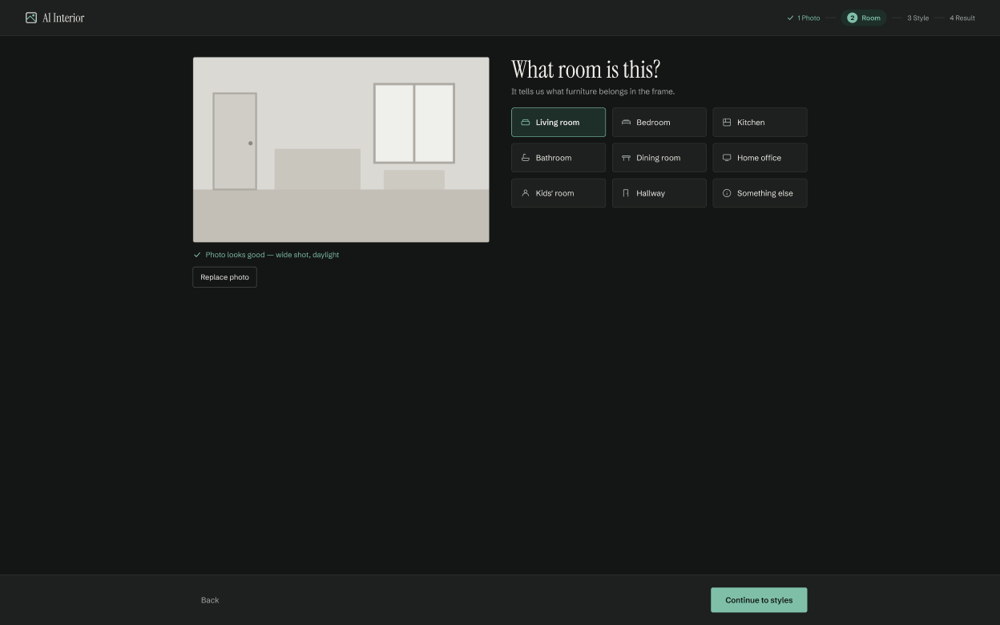

# AI Interior

A web app concept for finding a fresh look for your home: upload a photo of a room, pick one of four styles — Japandi, Scandinavian, Industrial or Mid-century modern — and get a visualization of that same room restyled.

The room's structure is never touched. Walls, windows, ceiling height and room size stay exactly as they are; doors stay in place; radiators, sockets, beams, fireplaces, stairs and niches stay where they are. Everything else — furniture, floor, wall colours, lighting, textiles — is redesigned in the chosen style, in its current (2026) interpretation.

**Status:** MVP built, not deployed yet. All screens from the UI design work on desktop and phone. Image generation has been tested against the real model in a spike ([`spike/REPORT.md`](spike/REPORT.md)); the full app flow has so far been tested with stubbed API responses.

## Problem

People who want to refresh their flat often can't picture how their own room would look in a different style. Inspiration photos show other people's rooms, with other layouts and other light, so they don't help with the actual decision. Designing a room yourself takes skills most people don't have, and hiring a designer just to explore options is expensive.

AI Interior shows the user *their own* room in a new style, so they can compare options before spending money on anything.

## User

Someone furnishing or refreshing their home who:

- is not an architect or interior designer,
- wants to experiment,
- doesn't know yet which style suits them,
- wants to see the possibilities before making a decision.

## How it works

- **No accounts, no storage.** The photo and every result live only in the browser's memory. Closing or refreshing the tab ends the session; the browser warns first once there are results.
- **Two server routes** proxy the models and keep the API token off the client:
  - `POST /api/photo-check` — a vision LLM checks the photo (framing, light) and returns warnings the user can ignore.
  - `POST /api/generations` — the image model restyles the photo, then the vision LLM describes the changes (palette, key pieces, what changed, what was kept).
  - Both answer only same-origin requests that carry a valid [Cloudflare Turnstile](https://developers.cloudflare.com/turnstile/) token, with bodies up to 4 MB.
- **Models** run on the [Cloudflare Workers AI](https://developers.cloudflare.com/workers-ai/) free tier:
  - image: FLUX.2 klein 4B (`@cf/black-forest-labs/flux-2-klein-4b`),
  - photo check and description: Mistral Small 3.1 (`@cf/mistralai/mistral-small-3.1-24b-instruct`).
- **Free daily limit:** the free tier has one daily limit for the whole app. The spike ran 43 generations and 16 LLM calls in one day without reaching it, so the real ceiling is higher but not measured. Once it is used up, the app says so and asks the user to come back tomorrow (the limit resets at 00:00 UTC).

## Stack

| Area | Tools |
|---|---|
| UX requirements | Markdown — [`ustalenia-ux.md`](ustalenia-ux.md) (in Polish) |
| Wireframes | Figma — desktop and mobile |
| UI design | Figma, imported from HTML/CSS mockups with html.to.design |
| Typography | Instrument Serif, Schibsted Grotesk |
| Style card images | Generated with Google Gemini from text prompts only — no existing photos used as input |
| App | Nuxt 4 (client-only), Vue 3, Pinia, Zod, TypeScript |
| AI models | Cloudflare Workers AI — FLUX.2 klein 4B, Mistral Small 3.1 |
| Tests | Vitest, Vue Test Utils, happy-dom |
| Hosting | Vercel |
| AI assistance | Claude Code — UX analysis, wireframes, architecture, implementation |

## Screenshots

**Upload a photo**



**Pick the room type**



## Running locally

Requirements: Node.js 24 and a free [Cloudflare](https://dash.cloudflare.com/) account.

1. Create a Cloudflare API token from the **Workers AI** template (permission: Workers AI — Edit).
2. Create `.env` in the project root (it is git-ignored):

   ```
   CF_ACCOUNT_ID=your-account-id
   CF_API_TOKEN=your-api-token
   NUXT_PUBLIC_TURNSTILE_SITE_KEY=1x00000000000000000000BB
   TURNSTILE_SECRET_KEY=1x0000000000000000000000000000000AA
   ```

   The account ID is the 32-character part of the dashboard URL: `https://dash.cloudflare.com/<account-id>/home`.
   The two Turnstile values are Cloudflare's [test keys](https://developers.cloudflare.com/turnstile/troubleshooting/testing/): every check passes, so they are only for local work.
3. Install and start:

   ```
   npm install
   npm run dev
   ```

   The app runs at http://localhost:3000.

Other commands:

| Command | What it does |
|---|---|
| `npm test` | Runs unit tests, page tests in a Nuxt environment, and API route tests against a local stand-in for Cloudflare |
| `npm run test:e2e` | Runs end-to-end tests in the installed Google Chrome, with the API stubbed |
| `npm run typecheck` | Checks types, including `.vue` files |
| `npm run build` | Builds for production |

No test calls Cloudflare, so tests never use up the daily limit.

## Deployment

The app is set up for Vercel. The free Hobby plan covers it technically, but Vercel allows Hobby for [non-commercial personal use only](https://vercel.com/docs/limits/fair-use-guidelines); paid or client work needs Pro.

1. Import the repository into Vercel — it detects Nuxt on its own.
2. In the Cloudflare dashboard, create a Turnstile widget (Turnstile → Add widget, mode **Invisible**) for the Vercel domain.
3. Add the environment variables in the project settings: `CF_ACCOUNT_ID`, `CF_API_TOKEN`, and the widget's keys as `NUXT_PUBLIC_TURNSTILE_SITE_KEY` and `TURNSTILE_SECRET_KEY`.
4. Deploy.

Server functions may run for up to 60 seconds (`nuxt.config.ts`), because generating an image and describing it takes about 20 seconds and up to about 30 seconds (the image alone took 5–21 s in the spike, the description about 8 s more).

## Project structure

```
app/          pages, components, Pinia store, browser utilities
server/       API routes and the Workers AI client
shared/       types, styles, room types and error codes used on both sides
test/         Vitest tests, mirroring the source folders
spike/        model experiments and their report
docs/         implementation plan; docs/readme/ holds the images used in this README
```

## Design

- [AI Interior — UI designs](https://www.figma.com/design/2EZY7aWeKK9UJ8xMG1KQJy)
- [AI Interior — Wireframes](https://www.figma.com/design/JxUND3pEO9zgD67eCD3CKC)
